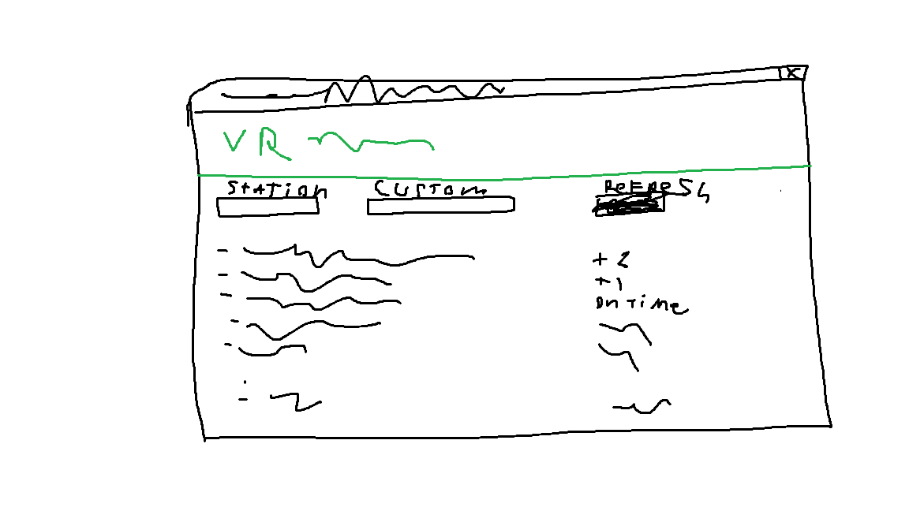
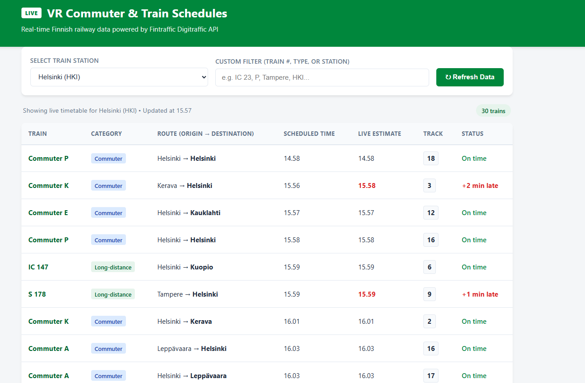

# live commuter traffic app

**Author(s):** Jesse Mitronen

## Project plan

### Project idea

Idea for this project was to make a site where you can see live timings of incoming trains from a station you want.

### Planned features

- **Live Station Selector:** Automatically fetches and populates all active Finnish passenger railway stations from the Digitraffic metadata API, defaulting to Helsinki.
- **Real-Time Timetable Schedule:** Displays upcoming train movements with scheduled times, live estimate adjustments, track numbers, and clear status badges (On time, Delayed, Cancelled).
- **Custom Instant Search & Filter:** Allows users to filter the active station's train list in real time by typing train numbers/lines (e.g., `IC 23`, `P`), categories, destinations, or track numbers.

### Wireframe / sketch

## Web links

- **Published application:** [Add your GitHub Pages URL here](https://jezzze.github.io/AJAX-application/)
- **GitHub repository:** [Add your repository URL here](https://github.com/jezzze/AJAX-application)

## About the application

**Live Commuter Traffic App** is a web application designed for railway passengers in Finland to check real-time train schedules. By integrating directly with the official Fintraffic Digitraffic open REST API using native AJAX (`XMLHttpRequest`), the application provides up-to-date schedule adjustments, delay notifications, and platform track numbers in a clean, responsive interface inspired by modern transit boards.

## Technologies

- HTML – page structure
- CSS – styling and layout
- JavaScript – functionality, DOM scripting and form validation
- **Fintraffic Digitraffic API:** Live JSON data source for Finnish railway traffic and station metadata.

## How to use the application

1. Open the published application using the link above or run it locally.
2. Select your desired train station from the dropdown menu at the top.
3. View the real-time table of incoming and departing trains.
4. Use the **Custom Filter** input field to instantly search for a specific train number, line letter, destination, or track.
5. Click the **Refresh Data** button at any time to pull the most recent schedule updates from the live server.
## Running the application locally

1. Clone or download this repository to your computer.
2. Open the project folder.
3. Open `index.html` in a web browser.

## Screenshots

## Known issues / limitations

**No known issues.**

## Self-assessment and learning reflection

- **What did I succeed in?** I successfully integrated a live public JSON API using native AJAX (`XMLHttpRequest`) without relying on external libraries or frameworks, implemented smooth real-time custom filtering, and built a clean, responsive UI.
- **What was challenging?** Handling and filtering nested JSON timetable structures from the Digitraffic API (such as mapping station short codes to full names and extracting specific departure rows) required careful data processing and array methods.
- **What would I improve if I had more time?** I would add an interactive map view showing train routes or a detailed modal popup showing the full stop-by-stop route history for a selected train.
- **What did I learn about HTML, CSS, JavaScript and DOM scripting?** I gained a deep understanding of asynchronous JavaScript (`Promises` and `async/await`), handling HTTP request lifecycle states with `XMLHttpRequest`, creating and appending DOM elements dynamically, and structuring maintainable code without inline event handlers.
- **What remained unclear or what would I like to learn more about?** I would like to explore WebSockets for real-time streaming data connections in future web projects.
- **My self-assessed project grade:** **10/10 points**

## Sources and acknowledgements

- [Fintraffic Digitraffic Railway API Documentation](https://www.digitraffic.fi/rautatieliikenne/)

## License

This project is licensed under the MIT License.

More information about adding a license to a GitHub repository:  
https://docs.github.com/en/communities/setting-up-your-project-for-healthy-contributions/adding-a-license-to-a-repository